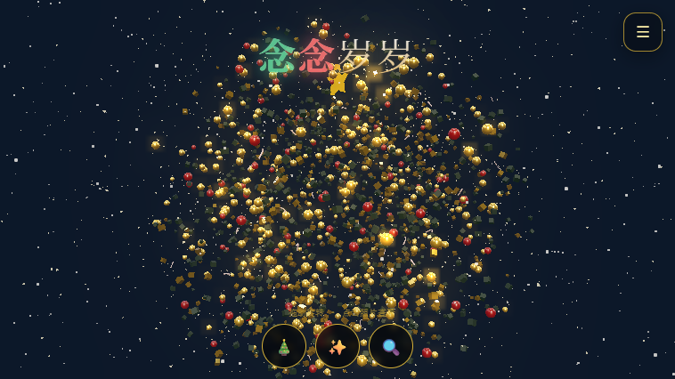

# 圣诞树 APK 移植版

[](https://github.com/xia3179679755-ui/gesture-christmas-tree-apk)
[](https://github.com/xia3179679755-ui/gesture-christmas-tree-apk)
[](LICENSE)

基于 [electronicminer/gesture-Christmas_tree-3d_with_photo](https://github.com/electronicminer/gesture-Christmas_tree-3d_with_photo) 整理的 **Android APK 移植版**。应用内的网页资源、Three.js、MediaPipe 和手势模型都已打包进 APK，安装后**不需要运行时访问 CDN 或本地服务器**。

本仓库**只发布可安装的 APK 和部署说明**，不重复发布上游网页源码。

## 应用展示

| 中文教程页 | 圣诞树聚合状态 |
|:---:|:---:|
|  |  |

### 圣诞树散开状态

<p align="center">
  
</p>

## 功能特性

- 🎄 **三种树形状态**：岁岁念念、念念岁岁、想念的每一天，按钮一键切换
- 👆 **触摸交互**：拖动旋转圣诞树
- ✋ **摄像头手势控制**：可按需启用；**只有**点击“启用摄像头手势”后才申请摄像头权限
- 🖼️ **照片导入**：可导入照片并保存在应用私有空间中，重启应用后仍可用
- 📖 **中文教程**：启动时显示使用教程，点击“进入应用”后进入圣诞树
- ⚙️ **画质选项**：自动、高画质、均衡、省电流畅

## 环境要求

- Android **7.0**（API 24）或更高版本的手机/平板
- 无需 Node.js、Python、Android Studio 或额外模型文件——所有资源已内置
- 首次安装需允许一次“安装未知应用”权限

## 安装步骤

1. 在本页下载 [gesture-christmas-tree.apk](gesture-christmas-tree.apk)。
2. 将 APK 传到 Android 手机并打开。
3. 如果系统提示“禁止安装未知来源应用”，只为当前使用的文件管理器或浏览器允许一次“安装未知应用”。
4. 安装完成后打开应用，先阅读教程，再点击进入主界面。

### APK 信息

| 项目 | 值 |
| --- | --- |
| 应用包名 | `com.codex.particlechristmastree` |
| 版本 | 1.0 (versionCode 1) |
| 最低 Android 版本 | Android 7.0（API 24） |
| 大小 | 约 18.9 MB |
| SHA-256 | `7A0AC1034E41E1F98D624C520855BCFC7644F2C27F21BEC99F413EAE3BA1139A` |

## 权限说明

| 权限 | 用途 |
| --- | --- |
| **摄像头** | 仅用于用户主动开启的手势控制，不开启手势时不会申请 |
| **网络** | 仅用于 Android WebView/Capacitor 的基础能力；运行所需的网页资源和模型已内置 |
| **存储** | 不申请公共存储读写权限。照片保存在应用私有的 IndexedDB 中 |

## 常见安装问题

### 点 APK 没有安装按钮

在系统设置中为当前打开 APK 的文件管理器或浏览器开启“允许安装未知应用”，然后返回重新打开 APK。

### 提示签名冲突或无法覆盖旧版本

先卸载手机上旧的测试版 `com.codex.particlechristmastree`，再安装本页 APK。卸载会清除该应用保存的照片。

### 应用启动后黑屏或停在启动页

确认设备为 Android 7.0 或更高版本，并重新下载安装完整 APK。不要在下载未完成时打开文件。

### 手势功能不可用

进入应用后点击“启用摄像头手势”，在系统权限弹窗中选择允许；拒绝权限不会影响触摸旋转和三个状态按钮。

## 维护者与开发者指引

- **对普通使用者**：下载 APK、允许一次安装权限、安装并打开即可，不需要任何开发环境。
- **对维护者/智能体**：本仓库是**发布产物仓库**，不提供可直接执行的 Gradle 源工程。APK 的完整移植工程保存在本地开发目录中。发布新版本时重新构建 APK，更新本页 APK 文件、版本号和 SHA-256 后再提交。
- **校验下载完整性**：可用以下命令核对 APK 的 SHA-256（Windows PowerShell）：

  ```powershell
  Get-FileHash .\gesture-christmas-tree.apk -Algorithm SHA256
  ```

## 仓库结构

```text
gesture-christmas-tree-apk/
├── gesture-christmas-tree.apk   # 可安装的 APK（约 18.9 MB）
├── tutorial.png                  # 教程页截图
├── tree-main.png                 # 聚合状态截图
├── tree-scatter.png              # 散开状态截图
├── README.md                     # 本文档
└── LICENSE                       # MIT
```

## 来源与许可

本 APK 的交互和视觉基础来自上游项目，感谢原作者 [electronicminer](https://github.com/electronicminer)。本仓库保留上游项目的 MIT 许可说明；APK 仅用于学习、测试和个人使用，请遵守上游项目许可及 Android 设备安全策略。
